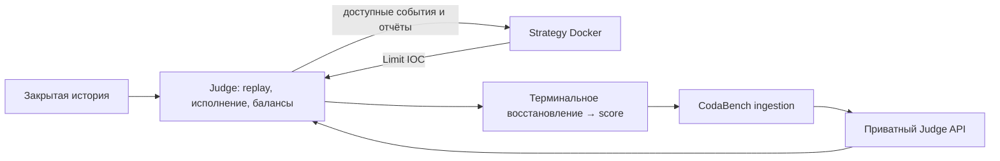

# Время, исполнение и score



Judge (`spot_contest/engine.py`) не импортирует код участника. Стратегия получает
JSON-сообщения; score рассчитывается только Judge. `participant_runner.py`
работает внутри контейнера участника и сам по себе защитой не является.

## Виртуальное время

Replay обрабатывает Unix nanoseconds без ожидания реального времени:

```text
начало callback = max(receive_ts_ns + extra_feed_latency_ns, освобождение стратегии)
приход заявки = начало callback + compute_latency_ns + order_latency_ns[биржа]
доставка отчёта = момент исполнения + report_latency_ns[биржа]
```

`market_ts_ns` определяет обновление рынка; `receive_ts_ns` уже включает
фактическую задержку получения. `extra_feed_latency_ns` добавляет только сценарную
задержку. Для frames доступное время описано в [контракте данных](data-contract.md).

При одинаковом времени порядок: обновления рынка → приход заявок → доставка
событий/отчётов → callback. Внутри класса сохраняется порядок входа/создания.
Callbacks последовательны; пока стратегия занята, рынок и заявки продолжают
обрабатываться. Заявка после последнего market event отклоняется `END_OF_DATA`;
новые решения после этой границы не запрашиваются.

## Балансы и ликвидность

Фактические остатки меняются при исполнении, наблюдаемые стратегией — при
доставке отчёта. Так баланс не раскрывает ещё не доставленные исполнения.
При принятии buy резервируется `qty × limit × (1 + fee)`, sell — `qty` базового
актива; после IOC резерв освобождается. Нельзя потратить одни средства дважды.

Две ноги исполняются независимо по текущей глубине. На уровне доступна доля
`depth_fraction × historical_qty`. Собственные сделки расходуют этот бюджет:
одинаковый snapshot его не пополняет, прирост глубины добавляет соответствующую
долю прироста, снижение уменьшает бюджет. Удалённый и появившийся заново уровень
считается новой ликвидностью. Исторические trades служат признаками и повторно
из L2 не вычитаются, чтобы не учитывать одну историческую сделку дважды.

Собственные сделки не меняют дальнейший исторический рынок. Поэтому модель
предназначена для небольших taker-сделок; очереди пассивных заявок отсутствуют.

## Итоговый результат

В конце на **каждой** бирже восстанавливается исходное количество базового актива:
излишек продаётся по bid, дефицит покупается по ask, с taker-комиссией.
Используется видимая оставшаяся глубина; лимит `depth_fraction` к этому расчёту
не применяется. Нехватка глубины или несвежий конечный стакан означает ошибку без score.

```text
initial_equity = сумма(initial_quote + initial_base × reference_price)
net_pnl = сумма(quote_after_restoration − initial_quote)
score = net_pnl / initial_equity
```

Это результат относительно удержания стартовых запасов: без сделок score равен
нулю даже при росте актива. `reference_price` — опубликованная опорная цена
стартового капитала. В `result.json` балансы показаны до восстановления,
его стоимость — в `terminal_rebalance`.

`max_drawdown` — диагностическая просадка baseline-relative mark-to-market equity
на событиях/сделках со свежими стаканами; терминальная корректировка в неё не входит.
`run.json` сохраняет правила, хеши кода, данных, сабмита и результатов, а для Docker —
ID образа. Ошибка стратегии, протокола или оценки оставляет `status=failed` без score.
